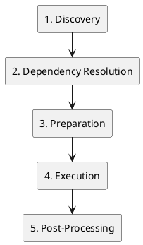

# Build Process Overview

ContainerHive builds container images through a pipeline of five steps:

## Pipeline Steps

1. **Discovery** (`ch generate`) - Find and validate `hive.yml` and image definitions.
2. **Dependency Resolution** - Build the dependency graph from `FROM __hive__/...` references and explicit `depends_on` entries.
3. **Preparation** (`ch generate`) - Apply templates and render build contexts to `dist/`.
4. **Execution** (`ch build`) - Build images with BuildKit in dependency order.
5. **Post-Processing** (`ch test`, `ch sbom`, `ch finalize`) - Run tests, generate SBOMs, create multi-arch manifests and alias tags.

## Execution model

- A single `ch build` run builds images one after another in dependency order, so a parent always exists before its children.
- To build in parallel, split the work across jobs. The generated CI pipeline has one stage per dependency depth, and [sharding](../usage/sharding.md) spreads the images of a stage across parallel jobs. See [How dependency resolution works](dependency-resolution.md).
- Parent images are passed to children as OCI layout named contexts, so no registry push is needed between steps.

## Other behavior

- Templates are processed with Go templates, see [Write your Dockerfiles](../usage/dockerfiles.md).
- Secrets are passed through BuildKit secret mounts, see [Secrets and versions](../usage/secrets-and-versions.md).
- A failed build stops the run with a non-zero exit code. Nothing is pushed for images that were not built.
