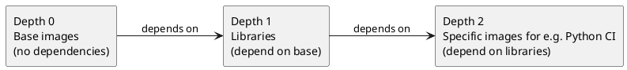
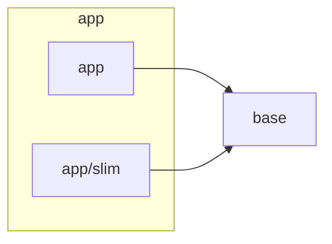

How dependency resolution works
==================

ContainerHive builds images in the correct order by resolving dependencies between them.

## How dependencies are discovered

Dependencies are resolved from two sources:

1. **Explicit declaration**: The `depends_on` field in `image.yml` lists images this image depends on.
2. **Automatic detection**: ContainerHive scans `FROM` statements in Dockerfiles to detect references to other images in the project.

Both sources are combined to build a directed acyclic graph (DAG) that determines the build order.

## Build order

Images are grouped into layers based on their dependency depth:

1. Images with no dependencies are built first (depth 0).
2. Images depending only on depth-0 images are built next (depth 1).
3. This continues until all images are built.

Images at the same depth can be built in parallel.

## Visualizing the graph

`ch graph` prints the graph as a [Mermaid](https://mermaid.js.org/) flowchart, or as Graphviz DOT with `--format dot`. Unlike the build order, which works per image, it shows each variant as its own node (`<image>/<variant>`), grouped with its image.

A reference such as `FROM __hive__/base:1.0-slim`, or a `parent` of that value, points at the variant of `base` whose `tag_suffix` the tag ends with. When several suffixes match, the longest wins. A tag without a matching suffix points at the base image. `depends_on` is set per image, so it applies to the image and to each of its variants. A variant that builds `FROM __hive_parent__` (or sets that as its Nix or Chisel `parent`) points at its own base image.

## Inter-image dependencies

When an image depends on another image in the project, ContainerHive uses OCI layout named contexts to pass the built image as a build context. This avoids needing to push intermediate images to a remote registry.

## CI pipeline generation

The dependency graph is also used to generate CI pipelines. Each depth level becomes a stage in the generated pipeline, allowing the CI system to parallelize builds within each stage.
