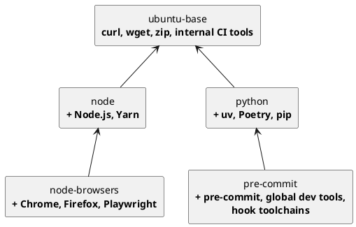
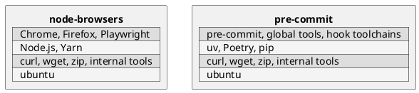
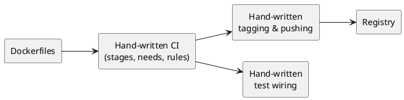
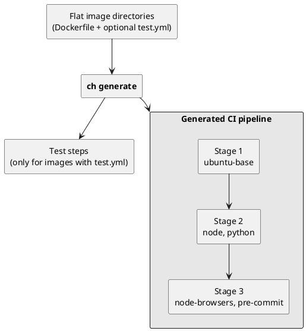

Why use ContainerHive?
===

Whether you're an individual maintaining a personal image catalog or a platform team providing base and runtime images across an organization — once you manage more than a handful of container images, the "simple" approach stops working.

## Who is this for?

ContainerHive is built for individuals and teams that maintain a set of container images. Think:

- **Base images** — hardened OS layers with security policies, monitoring agents, and standard tooling baked in.
- **Runtime images** — language-specific environments (Python, Node, Java, .NET) with approved versions, pre-installed dependencies, and consistent configuration.
- **Library images** — shared middleware, databases, or service meshes packaged as internal images.

These images form a dependency tree: runtime images depend on the base image, and variant images (e.g., `python:3.13-selenium`) layer on top of the runtime. When a base image changes, everything downstream needs to rebuild — in the right order.

If you're building a single application image from a `Dockerfile`, you probably don't need ContainerHive. But once you're managing a catalog of 10, 50, or 200+ image/tag combinations with interdependencies, tagging conventions, multi-platform builds, and CI pipelines — that's where it shines.

## A well-known pattern

The idea behind ContainerHive isn't new. Large organizations like Canonical, Chainguard, and Docker themselves manage their image catalogs through declarative definitions, dependency graphs, and automated pipelines. It's a proven pattern — but the tooling to do it has historically been internal, proprietary, or tightly coupled to a specific CI system.

ContainerHive brings this pattern to everyone as an open, CI-agnostic tool.

## The bash script trap

It usually starts with a `build.sh` that calls `docker build` in a loop. Then someone adds tagging logic. Then caching flags. Then multi-platform support. Then dependency ordering because image B depends on image A. Before long, you have hundreds of lines of brittle shell scripts that:

- **Break silently** when edge cases hit — whitespace in tags, failed pushes, partial builds.
- **Lack proper error handling** — a failed build halfway through leaves your registry in an inconsistent state.
- **Are impossible to test** without actually running builds.
- **Drift between environments** because every developer has a slightly different local version.
- **Can't reason about dependencies** — you either build everything every time or maintain a fragile manual ordering.

Shell scripts are great glue, but they're the wrong abstraction for a build system with dependency graphs, caching strategies, and multi-platform coordination.

## The "every team rolls their own" problem

Without a shared tool, each team independently solves the same problems — and makes different trade-offs. You end up with:

- **Duplicated effort**: Three teams, three custom build systems, three sets of bugs to maintain.
- **Inconsistent tagging**: One team uses `latest`, another uses semver, another uses commit SHAs. Consumers can't rely on conventions.
- **No shared caching**: Each team's CI pipeline starts from scratch because there's no common caching strategy.
- **Knowledge silos**: When the person who wrote team A's build scripts leaves, nobody knows how it works.
- **Compliance gaps**: SBOM generation and reproducibility are either applied inconsistently or not at all.

The cost isn't just engineering time — it's organizational friction. Onboarding is slower, audits are harder, and every team carries maintenance burden for infrastructure that isn't their core product.

## Example: a hierarchy of CI images

Take a typical set of CI images. Every job in your pipelines runs in one of them, and they build on each other:

| Image | Based on | Adds |
|:------|:---------|:-----|
| `ubuntu-base` | `ubuntu` | Essentials like `curl`, `wget`, `zip`, plus internal tools CI jobs can use |
| `node` | `ubuntu-base` | Node.js, Yarn, and friends |
| `node-browsers` | `node` | Chrome, Firefox, and Playwright |
| `python` | `ubuntu-base` | `uv`, Poetry, `pip`, and friends |
| `pre-commit` | `python` | `pre-commit`, commonly used global dev tools, and system-level installs of the ecosystems hooks rely on, so hooks don't install them on every run |

### Images stack, layers are reused

Each image only adds what is specific to it. Everything below comes from its parent, so the parent's layers exist once and are shared by every image built on top.



A change to `ubuntu-base` ripples down both branches. A change to `python` only affects `python` and `pre-commit`, and `node` and `node-browsers` are left alone.



The bottom two layers of both images, the Ubuntu base and the `ubuntu-base` tools, are identical. They are built once, cached once, and pulled once.

### Without ContainerHive

You build the machinery yourself:

- A hand-written CI pipeline with a job per image, `needs:` wired up so `node-browsers` waits for `node`, and `node` waits for `ubuntu-base`.
- Tagging and pushing logic so each child can find the exact parent it was built from.
- A test setup for each image, and the glue to run it in the right place in the pipeline.
- Updates to all of the above whenever you add, rename, or re-parent an image.



### With ContainerHive

You drop flat image directories into your project. Each image references its parent with `FROM __hive__/<image>`. ContainerHive does the rest.

```
images/
├── ubuntu-base/
│   ├── image.yml
│   ├── Dockerfile
│   └── test.yml
├── node/
│   ├── image.yml
│   └── Dockerfile          # FROM __hive__/ubuntu-base
├── node-browsers/
│   ├── image.yml
│   ├── Dockerfile          # FROM __hive__/node
│   └── test.yml
├── python/
│   ├── image.yml
│   └── Dockerfile          # FROM __hive__/ubuntu-base
└── pre-commit/
    ├── image.yml
    ├── Dockerfile          # FROM __hive__/python
    └── test.yml
```

There is no hierarchy to model. The directories stay flat, and the stacking is just the `FROM` line in each Dockerfile. From that, ContainerHive:

- **Resolves the dependency graph** and works out the build order.
- **Generates the CI pipeline** with one stage per depth, so `node` and `python` build in parallel once `ubuntu-base` is done.
- **Detects which images have tests** by looking for a `test.yml` next to the Dockerfile, and adds the test steps for exactly those images.
- **Passes parent images to children** directly during the build, without a registry round trip.



Adding a new image, say a `go` image on top of `ubuntu-base`, means adding a directory with a Dockerfile that starts with `FROM __hive__/ubuntu-base`. The pipeline, the ordering, and the test steps follow from that.

## What ContainerHive does instead

ContainerHive gives every team the same declarative workflow:

- **Image definitions in YAML** — no imperative scripts, just data describing what you want.
- **Automatic dependency resolution** — images are built in the right order based on their `FROM` relationships.
- **CI pipeline generation** — GitLab CI, GitHub Actions, or custom templates, generated from the same source of truth.
- **Built-in caching** — S3 or registry-backed caching works out of the box, shared across local and CI builds.
- **Testing lives next to the code** — test definitions live side by side with your image definitions and are generated together, so the build and its validation are always in sync.
- **SBOM generation** — CycloneDX SBOMs for every image, every build, without extra tooling.
- **Single binary, no runtime** — drop it into any environment. No Python, no Node, no dependencies beyond BuildKit.
- **Bring your own BuildKit** — ContainerHive doesn't manage or bundle a container runtime. Point it at any BuildKit instance via `BUILDKIT_HOST` — whether that's a local daemon, a shared cluster service, or a sidecar container in a hardened Kubernetes environment with custom security policies and restricted privileges.

Effort goes into building images, not building build systems.
